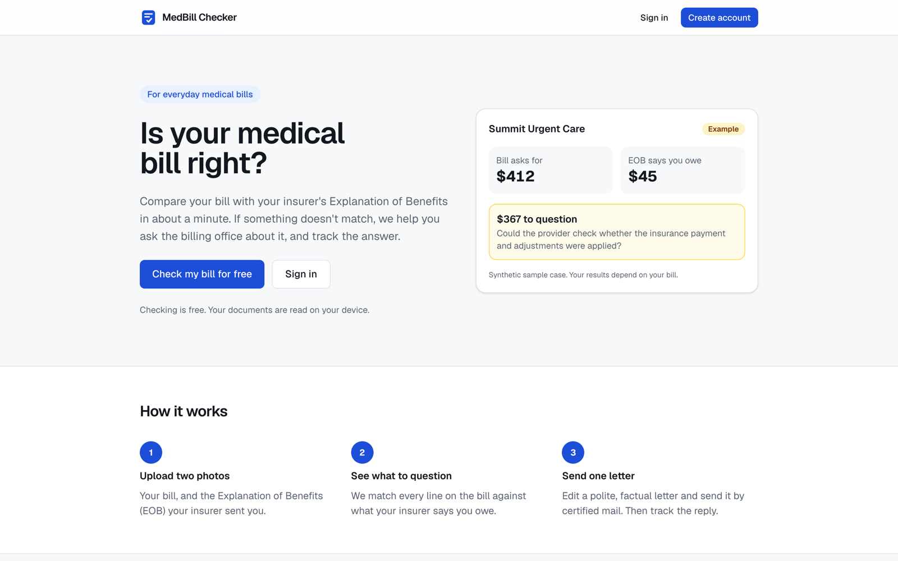
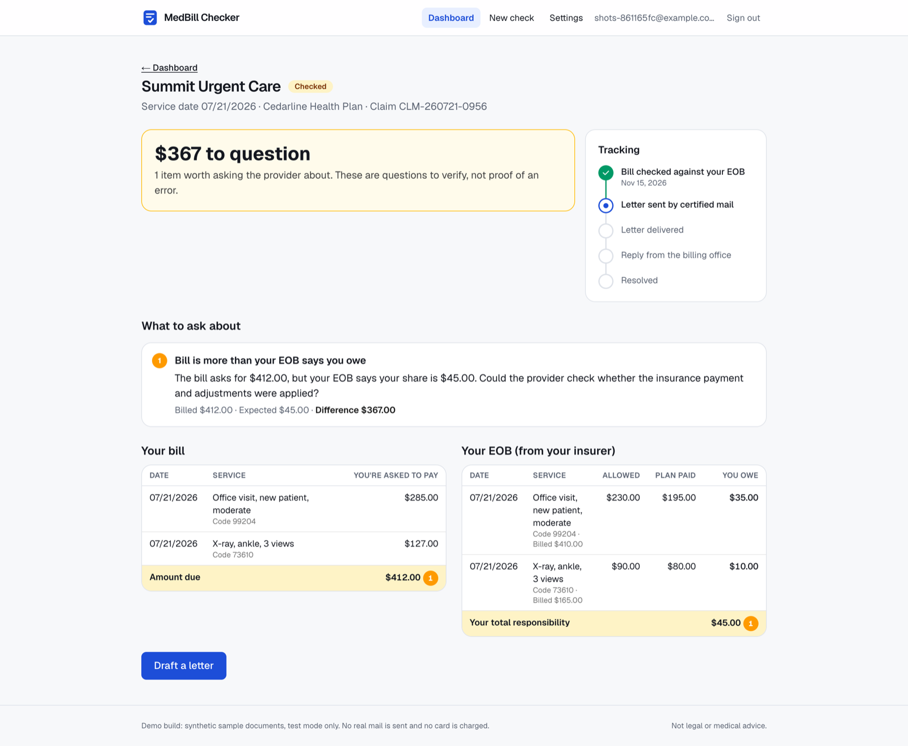
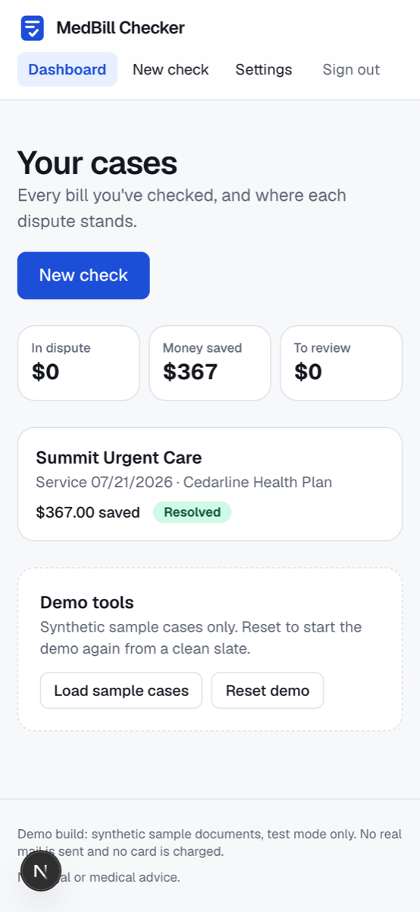
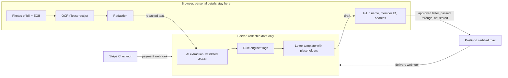

<div align="center">

# MedBill Checker

### Catch overcharges on your medical bill, and send the dispute letter for you.

Upload a bill and your insurer's Explanation of Benefits (EOB). MedBill compares them line by line, flags what
doesn't add up, drafts a polite letter, sends it by certified mail, and tracks the outcome.

**[Try the live demo →](https://medbill-zimran.vercel.app)**
<br>
<sub>Test mode, synthetic data. No real mail is sent and no card is charged.</sub>


<br>




</div>

## The problem

Medical bills often ask for more than the insurer says you owe: a charge listed twice, a service the insurer
never saw, or a balance that ignores the insurance payment. Checking means comparing two confusing documents
line by line. Disputing means writing a letter and mailing it. Most people just pay.

## The solution

One loop, working end to end:

| Step | What happens |
| --- | --- |
| **1. Upload** | A photo of the bill and of the EOB (or a one-click sample case) |
| **2. Read on your device** | OCR and redaction run in the browser. Your name, date of birth, member ID and address never reach the AI |
| **3. Extract** | AI turns the redacted text into structured data, validated against strict types |
| **4. Check** | A tested rule engine (no AI) flags duplicates, items missing from the EOB, items the EOB says cost $0, and totals above your share |
| **5. Letter** | A factual letter is drafted from a fixed template. You edit it; your details are filled in on your device |
| **6. Send** | Certified mail through PostGrid, paid through Stripe |
| **7. Track** | Delivery status, the provider's reply, and the money you saved |

The bill and the EOB side by side, each flag explained as a question to verify:



Every case, its status, and the money in dispute, saved and still to review:



## Try it in 2 minutes

1. Open the [live demo](https://medbill-zimran.vercel.app) and create an account (any email, no confirmation).
2. In **Settings**, enter a made-up name, date of birth, member ID and address.
3. In **New check**, click **C: billed too much**, then **Read my documents** and **Check my bill**.
   You'll see **$367 to question**.
4. Click **Draft a letter**, **Approve letter**, then **Pay $14.99 and send**.
   Use card `4242 4242 4242 4242` with any future date and any CVC.
5. Click **Simulate delivery**, then **I got a reply**, choose **Corrected the bill** and use the sample statement.
6. The dashboard now shows **$367 saved**. **Demo tools → Reset demo** starts over.

Short on time? **Demo tools → Load sample cases** on the dashboard adds all three cases at once:

| Sample | Bill | Result |
| --- | --- | --- |
| A | Lakeside Family Medicine | Clean: nothing to question |
| B | Riverbend Medical Group | A lab test charged twice: $28.75 to question |
| C | Summit Urgent Care | Bill asks $412, EOB says $45: $367 to question |

Sample A matters as much as B and C: a correct bill gets no flags.

## How it works



## What makes it different

- **Private by design.** OCR and redaction run on your device, and Tesseract is self-hosted so it makes no
  outside requests. The AI only ever sees redacted text. The letter is drafted with placeholders, filled in by
  the browser at approval, and passed straight to the mail provider without being stored.
- **AI reads, rules decide.** The AI only extracts data. Its output is schema-validated, retried once if
  invalid, and cached. Every flag comes from a deterministic, unit-tested function, so every number can be explained.
- **Questions, not accusations.** Flags and letters ask the provider to verify. No legal claims.
- **Payments done properly.** Access is granted only by a signature-verified, idempotent Stripe webhook, never
  by the redirect back from Checkout. Refunds, failed renewals and cancellations are handled.
- **Your cases are yours.** Every route checks the signed-in user. Someone else's case returns 404.

## Business model

| | Price | Includes |
| --- | --- | --- |
| Check | Free | Upload, review every line, draft and edit the letter, track replies |
| Single letter | $14.99 | One certified letter with tracking |
| Annual plan | $39/year | Four certified letters a year |

The paid step is the one that costs money to deliver. A certified letter costs about $5–10 to send, leaving
roughly $4–9 per single letter after fees. People get a few medical bills a year, so paying per letter fits
better than a monthly subscription.

## Tested

- **182 unit tests** (Vitest) cover the flag rules, redaction on real OCR output, billing rules, replies and the timeline.
- **Browser end-to-end checks** (Playwright) cover each feature. `npm run e2e:stripe` goes through payment,
  webhook and send, a declined card, a refund, a blocked 5th plan letter, a failed renewal and a cancellation.
  `npm run e2e:demo` runs the full demo three times in a row.

## What's next

- Import EOBs directly from insurers instead of uploading them.
- Attach replies automatically through a per-case reply address or a mail-scanning service.
- Deadline reminders: when to follow up, and when to escalate to the insurer or a regulator.
- A shareable outcome summary for resolved cases, with personal details removed.

## Run locally

```bash
npm install
cp .env.example .env.local   # Supabase, Gemini, PostGrid test key, Stripe test key
# run supabase/migrations/*.sql in the Supabase SQL editor
npm run stripe:setup         # creates the two test Prices
npm run dev:stripe           # dev server + Stripe webhook forwarding (needs the Stripe CLI)
```

Checks: `npm run test` · `npm run lint` · `npm run build`

## Project map

| Path | What |
| --- | --- |
| `lib/flags.ts` | Bill ↔ EOB matching and the flag rules |
| `lib/redact.ts` | On-device redaction |
| `lib/extract*.ts` | AI extraction (Gemini by default, Claude via `EXTRACT_PROVIDER`) and its cache |
| `lib/letter.ts` | Letter template |
| `lib/mail/` | PostGrid certified mail (test key only) |
| `lib/billing*.ts` | Payment rules and Stripe webhook handling |
| `docs/spec.md` | The full contract: types, rules, API |
| `docs/tasks.md` | Build log, task by task |

---

<sub>All documents are synthetic. Test mode only: no real mail is sent and no card is charged. Not legal or medical advice.</sub>
